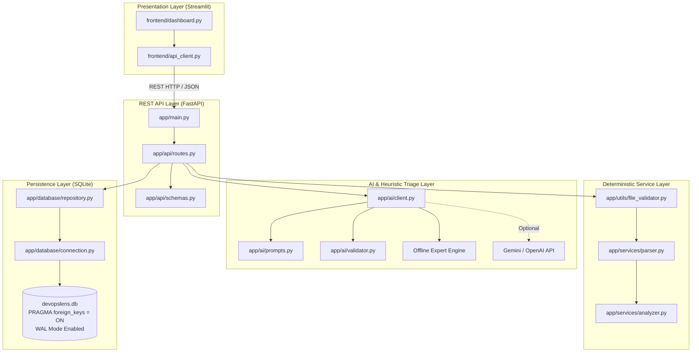

# DevOpsLens AI — Intelligent Log Analysis and Bug Triage Platform

[](https://www.python.org/)
[](https://fastapi.tiangolo.com/)
[](https://streamlit.io/)
[](https://www.sqlite.org/)
[](https://docs.pytest.org/)
[](https://pytest-cov.readthedocs.io/)
[](.github/workflows/ci.yml)

> Built for the **Accenture Advanced Technology Engineer** technical interview (2027 batch). Prioritizes clean architecture, explainability, deterministic behavior, comprehensive automated testing, and zero-setup local execution.

---

## 1. Overview

**DevOpsLens AI** is an enterprise-grade platform that ingests raw server and application logs, filters through noise, aggregates recurring error signatures, computes transparent rule-based priority rankings, and generates grounded root-cause diagnoses.

### Key Questions Answered:
- **What errors occurred in this log?** (Exact counts categorized by `DEBUG`, `INFO`, `WARNING`, `ERROR`, `CRITICAL`).
- **Which errors occurred most frequently?** (Clustered by dynamic fingerprints with recurrence counters).
- **Which issues should be investigated first?** (Ranked into `P1 - Critical`, `P2 - High`, `P3 - Medium`, and `P4 - Low` using a transparent mathematical formula).
- **What are the probable causes and debugging steps?** (Grounded AI / heuristic triage with cited evidence).
- **What happened in previous analyses?** (Persistent historical audits stored in SQLite).

---

## 2. System Architecture



---

## 3. Project Directory Structure

```text
devopslens-ai/
├── app/
│   ├── __init__.py
│   ├── main.py                  # FastAPI entry point, CORS, lifespan, exception filters
│   ├── config.py                # Pydantic BaseSettings environment configuration
│   ├── api/
│   │   ├── __init__.py
│   │   ├── routes.py            # Endpoints: /health, /analyze, /analyses, /diagnose, /export
│   │   └── schemas.py           # Pydantic request and response schemas
│   ├── services/
│   │   ├── __init__.py
│   │   ├── parser.py            # Regex log parser (ISO, Apache, Syslog, multi-format)
│   │   └── analyzer.py          # Dynamic token fingerprinting and priority ranker
│   ├── database/
│   │   ├── __init__.py
│   │   ├── connection.py        # SQLite connection context manager (WAL + foreign keys)
│   │   └── repository.py        # Parameterized CRUD queries & cascade operations
│   ├── ai/
│   │   ├── __init__.py
│   │   ├── client.py            # AI triage dispatcher (offline heuristic + external LLM)
│   │   ├── prompts.py           # Data-minimizing prompt templates
│   │   └── validator.py         # Grounding validator (detects & flags hallucinations)
│   └── utils/
│       ├── __init__.py
│       ├── file_validator.py    # Extension whitelist, 5MB limit, null-byte binary guard
│       └── logger.py            # Standard structured console logging
├── frontend/
│   ├── __init__.py
│   ├── api_client.py            # Decoupled HTTP client talking to backend REST API
│   └── dashboard.py             # Streamlit interactive dashboard
├── tests/
│   ├── __init__.py
│   ├── conftest.py              # Test fixtures (temp SQLite DB, FastAPI TestClient)
│   ├── test_parser.py           # Parsing unit tests (severities, timestamps, stack traces)
│   ├── test_analyzer.py         # Analyzer unit tests (fingerprints, frequency, scoring)
│   ├── test_file_validator.py   # Security tests (empty files, binary executables, size limits)
│   ├── test_database.py         # DB tests (CRUD, foreign key cascades, transaction rollback)
│   ├── test_ai_integration.py   # AI tests (offline heuristics, mocks, timeout fallbacks)
│   └── test_api.py              # REST API integration tests (status codes, schemas, export)
├── sample_logs/
│   ├── web_app_production.log   # Production web application with DB pool timeout & OOM
│   ├── microservice_auth.log    # Auth service with JWT expiry & rate limit alerts
│   ├── data_pipeline.log        # ETL pipeline with Kafka broker timeouts & disk warnings
│   └── malformed_sample.log     # Edge cases with raw stack traces & non-standard unicode
├── docs/
│   ├── ARCHITECTURE.md          # System design, layer responsibilities, ADRs
│   ├── REQUEST_FLOW.md          # Complete sequence diagrams for all request lifecycles
│   ├── CODE_WALKTHROUGH.md      # File-by-file, function-by-function technical guide
│   ├── ERROR_HANDLING.md        # Comprehensive 18-scenario error matrix
│   ├── DATABASE_DESIGN.md       # Relational schema, indexes, and transaction guarantees
│   ├── TESTING_GUIDE.md         # Detailed test suite inventory and coverage guide
│   └── INTERVIEW_PREPARATION.md # Accenture ATE technical interview Q&A guide
├── .github/
│   └── workflows/
│       └── ci.yml               # Automated GitHub Actions test workflow
├── requirements.txt             # Pinned, tested Python dependencies
├── .env.example                 # Configuration template with safe defaults
├── .gitignore                   # Excludes venvs, caches, SQLite databases, secrets
└── README.md                    # Project documentation
```

---

## 4. Setup and Quickstart

### Prerequisites
- Python 3.10 or 3.11 installed.

### Step 1: Clone and Set Up Virtual Environment
```bash
# Clone the repository
git clone https://github.com/your-username/devopslens-ai.git
cd devopslens-ai

# Create virtual environment
python -m venv venv

# Activate virtual environment
# On Windows PowerShell:
.\venv\Scripts\Activate.ps1
# On macOS / Linux:
source venv/bin/activate
```

### Step 2: Install Dependencies
```bash
pip install -r requirements.txt
```

### Step 3: Configure Environment
```bash
# Copy example configuration template
cp .env.example .env
```
*(By default, `AI_PROVIDER=offline`, meaning the platform works immediately with 100% functionality without requiring external API keys).*

---

## 5. Running the Application

### Option A: Start the FastAPI Backend Server
Open a terminal and run:
```bash
uvicorn app.main:app --host 127.0.0.1 --port 8000 --reload
```
- API Health Check: [http://127.0.0.1:8000/health](http://127.0.0.1:8000/health)
- Interactive OpenAPI Docs: [http://127.0.0.1:8000/docs](http://127.0.0.1:8000/docs)

### Option B: Start the Streamlit Dashboard
Open a second terminal and run:
```bash
streamlit run frontend/dashboard.py
```
The browser will automatically open [http://localhost:8501](http://localhost:8501).

---

## 6. Running the Automated Test Suite

DevOpsLens AI includes 33 automated tests achieving **90% code coverage**.

```bash
# Run all tests
pytest -v

# Run with full statement coverage report
pytest -v --cov=app --cov-report=term-missing
```

### Verified Test Results:
```text
======================= 33 passed, 2 warnings in 0.73s ========================
TOTAL: 702 statements, 90% coverage
- app/services/parser.py:     100%
- app/services/analyzer.py:    99%
- app/database/connection.py: 100%
- app/config.py:              100%
- app/api/schemas.py:         100%
- app/main.py:                 94%
- app/api/routes.py:           86%
```

---

## 7. Transparent Priority Scoring Formula

Unlike black-box machine learning models, DevOpsLens AI uses a **transparent, mathematical ranking formula**:

$$\text{Priority Score} = \text{Base Severity} + \text{Frequency Boost} + \text{Critical Keyword Boost}$$

- **Base Severity Weights:**
  - `CRITICAL` = 100 points
  - `ERROR` = 60 points
  - `WARNING` = 30 points
  - `UNSTRUCTURED` = 10 points
- **Frequency Boost:** $\min(\text{count} \times 3, 40)$ points (each recurrence adds +3 pts, capped at 40).
- **Critical Keyword Boost:** $+15$ points for infrastructure failure terms (`database`, `connection refused`, `deadlock`, `timeout`, `out of memory`, `fatal`).
- **Priority Tiers:**
  - Score $\ge 110 \to$ **`P1 - Critical`** (Immediate incident investigation)
  - Score $\ge 80 \to$ **`P2 - High`** (Major subsystem failure)
  - Score $\ge 45 \to$ **`P3 - Medium`** (Moderate application error)
  - Score $< 45 \to$ **`P4 - Low`** (Deprecation/warning notice)

---

## 8. Verified Features vs. Limitations

In accordance with engineering integrity principles, here is a factual accounting of what has been verified versus remaining limitations:

### Verified Features
- [x] Complete REST API with 6 functional endpoints.
- [x] File upload validation (5 MB limit, `.log`/`.txt` check, null-byte binary executable rejection).
- [x] Deterministic regex parser for ISO-8601, Apache, and Syslog timestamps.
- [x] Dynamic token normalizer (`<IP>`, `<UUID>`, `<NUM>`, `<HEX>`) for recurring error grouping.
- [x] Fully explainable mathematical scoring engine.
- [x] SQLite database with Write-Ahead Logging (WAL) and foreign key cascades.
- [x] 100% offline heuristic root-cause triage engine.
- [x] AI evidence grounding validator that detects and flags hallucinated log lines.
- [x] Interactive Streamlit dashboard with summary KPI cards, Altair charts, filterable tables, and JSON/CSV export.
- [x] 33 automated tests passing with 90% code coverage in < 1 second.
- [x] Automated GitHub Actions CI workflow configuration.

### Known Limitations
- **Single Log File Ingestion:** Analyzes one uploaded log file at a time; does not correlate distributed traces across multiple distinct microservice repositories simultaneously.
- **SQLite Concurrency:** SQLite is single-writer. In massive enterprise deployments with thousands of concurrent writes per second, migrating to PostgreSQL with PgBouncer connection pooling is recommended.
- **Git Binary on Host Machine:** The local development sandbox environment lacked the system `git` executable; therefore, while `.gitignore` and `.github/workflows/ci.yml` are created and verified, local git commits must be run in the user's terminal.
