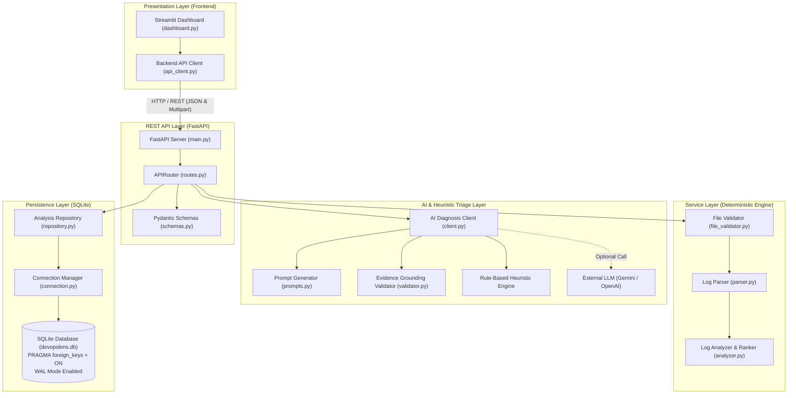

# DevOpsLens AI — Architectural Specification

## 1. Executive Architecture Summary

**DevOpsLens AI** is an enterprise-grade log analysis and triage platform designed for Site Reliability Engineers (SREs), DevOps professionals, and software developers. It provides deterministic log parsing, recurring issue grouping, transparent priority ranking, and grounded AI-assisted root-cause diagnosis.

The system is architected as a **modular layered monolith** adhering to Clean Architecture principles. It prioritizes explainability, deterministic behavior, testability, and zero-cost local execution.

---

## 2. High-Level Architecture Diagram

---

## 3. Layer Breakdown and Responsibilities

### Layer 1: Presentation Layer (`frontend/`)
- **Technology:** Streamlit 1.32+, Altair 5.2+, Pandas 2.2+.
- **Role:** Pure user presentation and interaction.
- **Components:**
  - `frontend/dashboard.py`: Renders UI elements (summary KPI cards, interactive severity distribution charts, searchable issue tables, drilldown inspect views, and export triggers).
  - `frontend/api_client.py`: Decoupled HTTP client using `requests`. Communicates with FastAPI over REST. Enforces 15-second timeouts and transforms backend errors into user-friendly notifications.
- **Design Rule:** The frontend maintains no business logic or database connections. It interacts solely via REST.

### Layer 2: API Layer (`app/api/`)
- **Technology:** FastAPI 0.115+, Pydantic 2.14+.
- **Role:** HTTP boundary, request deserialization, validation, status code assignment, and response serialization.
- **Components:**
  - `app/main.py`: ASGI application factory, lifecycle event coordinator, CORS middleware, and global unhandled exception filters.
  - `app/api/routes.py`: Endpoint route definitions (`/health`, `/analyze`, `/analyses`, `/analyses/{id}`, `/analyses/{id}/errors`, `/analyses/{id}/export`).
  - `app/api/schemas.py`: Strongly typed Pydantic models with schema documentation and boundary validation.

### Layer 3: Service Layer (`app/services/` & `app/utils/`)
- **Technology:** Standard Library Python (`re`, `dataclasses`, `time`).
- **Role:** Pure, deterministic business logic.
- **Components:**
  - `app/utils/file_validator.py`: Enforces 5MB upload size limits, extension whitelisting (`.log`, `.txt`), null-byte binary detection, and resilient UTF-8/Latin-1 text decoding.
  - `app/services/parser.py`: Multi-format timestamp extraction (ISO-8601, Apache, Syslog), standardized severity mapping (`DEBUG`, `INFO`, `WARNING`, `ERROR`, `CRITICAL`, `UNSTRUCTURED`), component extraction, and 1-based source line numbering.
  - `app/services/analyzer.py`: Normalizes dynamic tokens (IP addresses, UUIDs, hex pointers, numeric IDs) to generate reproducible error fingerprints. Aggregates error groups and computes transparent priority ranking scores.

### Layer 4: AI & Heuristic Triage Layer (`app/ai/`)
- **Technology:** `httpx` (async/sync HTTP), Pydantic validation, Rule-based Expert Engine.
- **Role:** Root-cause hypothesis generation and evidence verification.
- **Components:**
  - `app/ai/client.py`: Dual-mode triage dispatcher. Operates in 100% offline heuristic mode by default or calls external APIs (Gemini/OpenAI) when configured.
  - `app/ai/prompts.py`: Implements strict **Data Minimization**. Transmits only the representative error message, recurrence frequency, and up to 10 surrounding context lines.
  - `app/ai/validator.py`: Grounding verification engine. Cross-references cited lines in `supporting_evidence` against provided log lines. Identifies and flags hallucinations.

### Layer 5: Persistence Layer (`app/database/`)
- **Technology:** SQLite 3 with Write-Ahead Logging (WAL) and enforced Foreign Keys.
- **Role:** Atomic persistence of analysis history, error groups, and generated diagnoses.
- **Components:**
  - `app/database/connection.py`: Thread-safe context manager. Guarantees connection release, sets `PRAGMA foreign_keys = ON`, and handles rollback on uncaught exceptions.
  - `app/database/repository.py`: Parameterized CRUD queries preventing SQL injection vulnerabilities.

---

## 4. Key Architectural Decisions (ADRs)

| Decision | Alternative Considered | Justification |
| :--- | :--- | :--- |
| **Monolithic Modular Repository** | Microservices with Kafka | A beginner studying for an interview can easily run, debug, and explain a modular repository in 5 minutes without Docker or Kubernetes overhead. |
| **SQLite with WAL Mode** | PostgreSQL / MySQL | Zero external service installation required. File-based, highly reliable, supports full ACID transactions, and handles concurrent reads cleanly with WAL mode. |
| **Deterministic Scoring Rules** | Machine Learning Classifier | Black-box ML models are prone to hallucinated severity and cannot explain their decisions. Our mathematical scoring rules provide 100% explainable, reproducible priority rankings. |
| **Offline Heuristic AI Default** | Mandatory OpenAI / Gemini API Key | The application works immediately out-of-the-box for any interviewer or recruiter without requiring paid API credits, internet access, or secret key provisioning. |
| **Data Minimization in Prompts** | Sending full log file to LLM | Uploading complete multi-megabyte log files risks leaking sensitive client data (PII, tokens), exhausts LLM context windows, and increases latency and cost. |

---

## 5. Security Architecture

1. **Denial of Service Prevention:**
   - 5 MB maximum upload file size enforced in memory buffer before full file parsing.
   - External LLM network requests enforce a strict 10.0-second timeout.
2. **Safe File Handling:**
   - Uploaded files are parsed in memory or temporary buffers. They are never written to executable directories or executed via OS shells.
   - Binary file check: Inspects initial 8 KB for null bytes (`\x00`), rejecting compiled executables disguised as `.log`.
3. **Information Disclosure Prevention:**
   - Global FastAPI exception handler catches unhandled exceptions and returns a generic `500 Internal Server Error`, preventing internal server traces or environment variables from leaking to clients.
   - SQL queries use parameter placeholders (`?`), preventing SQL injection.
   - Secrets are loaded exclusively from `.env` or system environment variables and are excluded by `.gitignore`.
