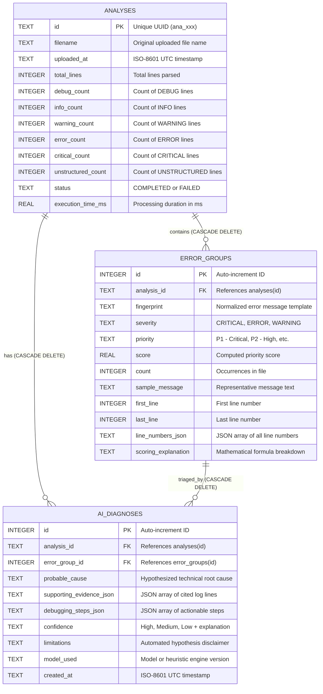

# DevOpsLens AI — Database Design and Architecture

This document describes the relational database schema, indexing strategy, transaction lifecycle, and data integrity guarantees implemented in DevOpsLens AI.

---

## 1. Database Technology Selection

- **Database Engine:** SQLite 3 (Standard Library `sqlite3`)
- **Journaling Mode:** Write-Ahead Logging (`PRAGMA journal_mode = WAL;`)
- **Foreign Key Enforcement:** Explicitly enabled (`PRAGMA foreign_keys = ON;`)
- **Row Representation:** `sqlite3.Row` (allows dictionary-like key access by column name)

### Why SQLite for DevOpsLens AI?
1. **Zero External Dependencies:** Eliminates the need to run, configure, and maintain an external database server (like PostgreSQL or MySQL), allowing any interviewer or developer to run the project with zero friction.
2. **ACID Compliant:** Supports full Atomic, Consistent, Isolated, and Durable transactions.
3. **High Read Throughput with WAL Mode:** Write-Ahead Logging allows concurrent readers to query the database simultaneously while a write transaction is appending new analysis records.
4. **Clean Migration Path:** The schema uses standard ANSI SQL data types and relationships, making future migration to PostgreSQL straightforward.

---

## 2. Entity-Relationship Diagram (ERD)



---

## 3. Detailed Table Specifications

### 3.1. Table: `analyses`
Stores top-level metadata and aggregate counts for each analyzed log file.

| Column | Data Type | Constraints | Description |
| :--- | :--- | :--- | :--- |
| `id` | `TEXT` | `PRIMARY KEY` | Unique analysis identifier (e.g. `ana_a1b2c3d4e5f6`). |
| `filename` | `TEXT` | `NOT NULL` | Sanitized original log filename. |
| `uploaded_at` | `TEXT` | `NOT NULL` | UTC ISO-8601 timestamp of analysis creation. |
| `total_lines` | `INTEGER` | `NOT NULL` | Total line count in source log file. |
| `debug_count` | `INTEGER` | `NOT NULL` | Number of DEBUG lines detected. |
| `info_count` | `INTEGER` | `NOT NULL` | Number of INFO lines detected. |
| `warning_count`| `INTEGER` | `NOT NULL` | Number of WARNING lines detected. |
| `error_count` | `INTEGER` | `NOT NULL` | Number of ERROR lines detected. |
| `critical_count`| `INTEGER`| `NOT NULL` | Number of CRITICAL / FATAL lines detected. |
| `unstructured_count`| `INTEGER`| `NOT NULL`| Number of unparsed or stack trace continuation lines. |
| `status` | `TEXT` | `NOT NULL DEFAULT 'COMPLETED'` | Status of analysis processing (`COMPLETED` or `FAILED`). |
| `execution_time_ms`| `REAL` | `NOT NULL` | Measured execution time for parsing and analysis. |

### 3.2. Table: `error_groups`
Stores distinct, clustered error signatures and their calculated priority rankings.

| Column | Data Type | Constraints | Description |
| :--- | :--- | :--- | :--- |
| `id` | `INTEGER` | `PRIMARY KEY AUTOINCREMENT` | Unique database identifier. |
| `analysis_id` | `TEXT` | `NOT NULL, FOREIGN KEY (analysis_id) REFERENCES analyses(id) ON DELETE CASCADE` | Parent analysis identifier. |
| `fingerprint` | `TEXT` | `NOT NULL` | Normalized message signature with dynamic tokens replaced. |
| `severity` | `TEXT` | `NOT NULL` | Highest observed severity level within this group. |
| `priority` | `TEXT` | `NOT NULL` | Transparent tier: `P1 - Critical`, `P2 - High`, `P3 - Medium`, `P4 - Low`. |
| `score` | `REAL` | `NOT NULL` | Numerical ranking score from transparent formula. |
| `count` | `INTEGER` | `NOT NULL` | Number of occurrences in the log file. |
| `sample_message` | `TEXT` | `NOT NULL` | Representative raw message string. |
| `first_line` | `INTEGER` | `NOT NULL` | First line number where this issue occurred. |
| `last_line` | `INTEGER` | `NOT NULL` | Most recent line number where this issue occurred. |
| `line_numbers_json`| `TEXT` | `NOT NULL` | Serialized JSON array of all source line numbers (e.g. `[10, 15, 22]`). |
| `scoring_explanation`| `TEXT` | `NOT NULL` | Plain-English breakdown of the score formula. |

### 3.3. Table: `ai_diagnoses`
Stores root-cause diagnoses generated by the AI or heuristic engine.

| Column | Data Type | Constraints | Description |
| :--- | :--- | :--- | :--- |
| `id` | `INTEGER` | `PRIMARY KEY AUTOINCREMENT` | Unique diagnosis record ID. |
| `analysis_id` | `TEXT` | `NOT NULL, FOREIGN KEY (analysis_id) REFERENCES analyses(id) ON DELETE CASCADE` | Linked analysis. |
| `error_group_id` | `INTEGER` | `FOREIGN KEY (error_group_id) REFERENCES error_groups(id) ON DELETE CASCADE` | Linked error group (if triaged specifically). |
| `probable_cause` | `TEXT` | `NOT NULL` | Inferred root cause hypothesis. |
| `supporting_evidence_json` | `TEXT` | `NOT NULL` | JSON array of grounded log line excerpts. |
| `debugging_steps_json` | `TEXT` | `NOT NULL` | JSON array of prioritized diagnostic actions. |
| `confidence` | `TEXT` | `NOT NULL` | Confidence tier and rationale. |
| `limitations` | `TEXT` | `NOT NULL` | Automated hypothesis caveats and disclaimer. |
| `model_used` | `TEXT` | `NOT NULL` | Identifier of the engine/model utilized. |
| `created_at` | `TEXT` | `NOT NULL` | UTC ISO-8601 creation timestamp. |

---

## 4. Performance Optimization and Indexes

Two targeted B-tree indexes are created to optimize the most frequent application queries:

1. **`idx_analyses_uploaded_at`:**
   ```sql
   CREATE INDEX IF NOT EXISTS idx_analyses_uploaded_at ON analyses (uploaded_at DESC);
   ```
   - **Purpose:** Optimizes the `GET /analyses?limit=50&offset=0` query used by the dashboard's History tab, avoiding costly full table scans when ordering by upload date.

2. **`idx_error_groups_analysis_id`:**
   ```sql
   CREATE INDEX IF NOT EXISTS idx_error_groups_analysis_id ON error_groups (analysis_id);
   ```
   - **Purpose:** Accelerates the foreign key lookups performed during `GET /analyses/{id}` and `GET /analyses/{id}/errors`.

---

## 5. Transaction and Connection Management

All database interactions flow through the `get_db_connection()` context manager in `app/database/connection.py`:

```python
@contextmanager
def get_db_connection(custom_path: Optional[str] = None):
    conn = sqlite3.connect(db_path, timeout=10.0, check_same_thread=False)
    conn.row_factory = sqlite3.Row
    try:
        conn.execute("PRAGMA foreign_keys = ON;")
        if db_path != ":memory:":
            conn.execute("PRAGMA journal_mode = WAL;")
        yield conn
        conn.commit()  # Automatic commit on clean block exit
    except Exception as exc:
        conn.rollback()  # Automatic rollback on any error
        raise
    finally:
        conn.close()   # Guaranteed resource release
```

### Guarantees
- **Atomicity:** `save_analysis()` inserts both the parent record in `analyses` and all associated records in `error_groups` inside a single transaction. If the system crashes midway or an error occurs, `conn.rollback()` ensures no orphaned partial analyses remain in the database.
- **SQL Injection Prevention:** Every query in the repository uses parameter placeholders (`?`). String concatenation is strictly prohibited.
- **Referential Integrity:** `PRAGMA foreign_keys = ON;` is executed on every opened connection. Deleting an analysis automatically cascades and cleans up child `error_groups` and `ai_diagnoses` via `ON DELETE CASCADE`.

---

## 6. Enterprise Scaling and Migration Path

While SQLite is ideal for single-instance applications, interviews often ask how the system scales in a large enterprise:

| Feature | Current SQLite Architecture | Future PostgreSQL Enterprise Migration |
| :--- | :--- | :--- |
| **Concurrency** | Single writer, multiple concurrent readers via WAL mode | Multi-master concurrent writes with connection pooling (PgBouncer) |
| **JSON Support** | Stored as `TEXT`, deserialized via `json.loads` | Native `JSONB` with GIN indexing for fast querying inside log JSON |
| **Clustering** | Single local filesystem / persistent volume | Distributed cluster with read replicas and automated failover |
| **Migration Cost** | Low. SQLAlchemy or asyncpg can replace `repository.py` with identical domain interfaces. |
