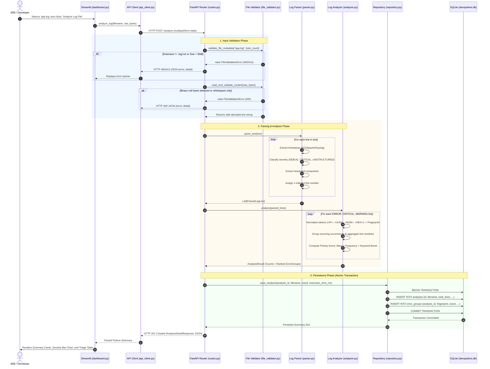
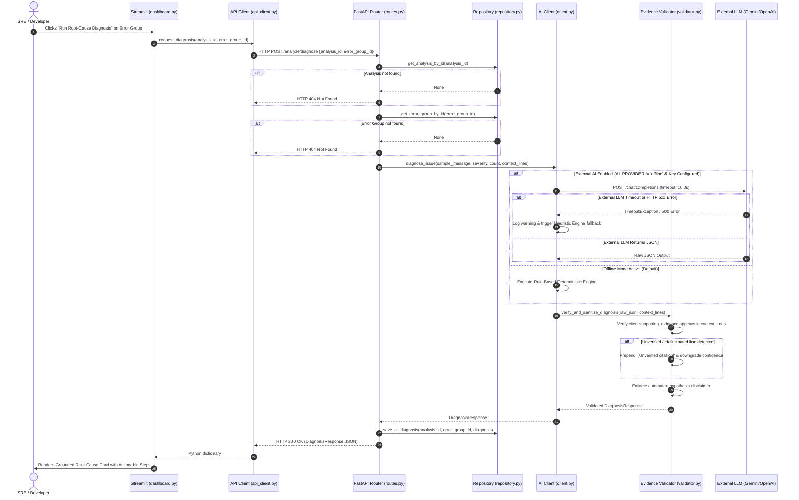

# DevOpsLens AI — Request Lifecycle and Data Flow

This document details the step-by-step lifecycle of requests through DevOpsLens AI, detailing the interactions between the frontend, API router, domain services, database, and AI engine.

---

## 1. Primary Request Flow: Log File Upload and Analysis (`POST /analyze`)

The diagram below illustrates what happens from the instant a user drops a `.log` file into Streamlit until the interactive report renders on screen.



---

## 2. Secondary Request Flow: Root-Cause Diagnosis (`POST /analyze/diagnose`)

Triggered on-demand when a user clicks **"Run Root-Cause Diagnosis"** on an error group.



---

## 3. Historical Query Flow: Browse Analyses (`GET /analyses`)

1. User switches to the **Analysis History** tab in Streamlit.
2. `dashboard.py` calls `api_client.get_analyses(limit=25, offset=0)`.
3. FastAPI receives `GET /analyses?limit=25&offset=0`.
4. `AnalysisRepository.get_analyses(limit=25, offset=0)` executes:
   ```sql
   SELECT id, filename, uploaded_at, total_lines, debug_count,
          info_count, warning_count, error_count, critical_count,
          unstructured_count, status, execution_time_ms
   FROM analyses
   ORDER BY uploaded_at DESC
   LIMIT ? OFFSET ?;
   ```
5. SQLite returns the recent records through Write-Ahead Log (WAL) reader without blocking active writers.
6. Pydantic validates and serializes each row into `List[AnalysisSummaryResponse]`.
7. Streamlit renders a sortable Pandas data table.
8. Selecting an analysis ID calls `GET /analyses/{id}` to fetch full error group details and restores the complete analysis state in the UI without re-uploading the file.
